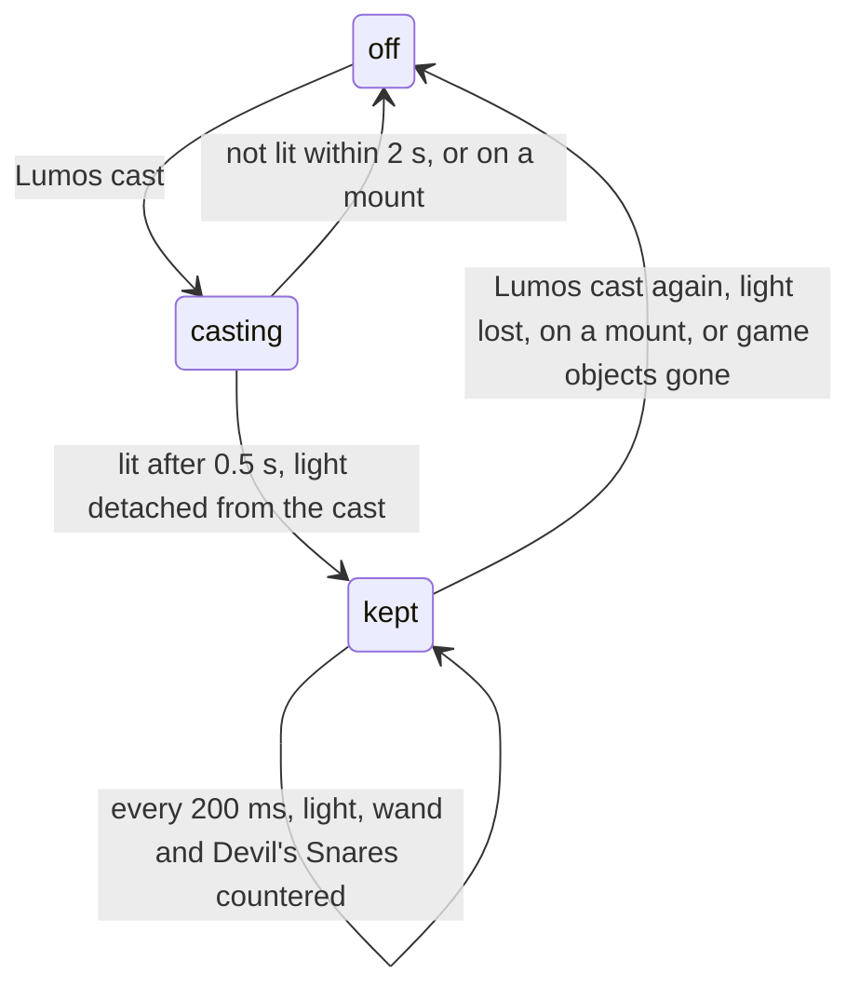

# Hogwarts Legacy Lumos keeper

Lumos spell won't be disabled anymore after any action that turn it of in the vanilla game (other spell, roll, interaction) and will be kept on until lumos is casted again.

## How it works

- the mod tracks when lumos is casted and retriggers the light every 200 ms so the other actions like spells and rolls that usually turn it off don't affect this anymore.
- when the lumos casted again while active the mod will turn it off.
- on mounts the mod resets it's active state.
- the kept light of Lumos always affects the Devil's Snares, so they won't hurt the player.

## Compatibility

The mod should be compatible with any other mods and any game input that triggers the Lumos spell, since this mods tracks the cast itself and is not relying on the specific key-combos.
