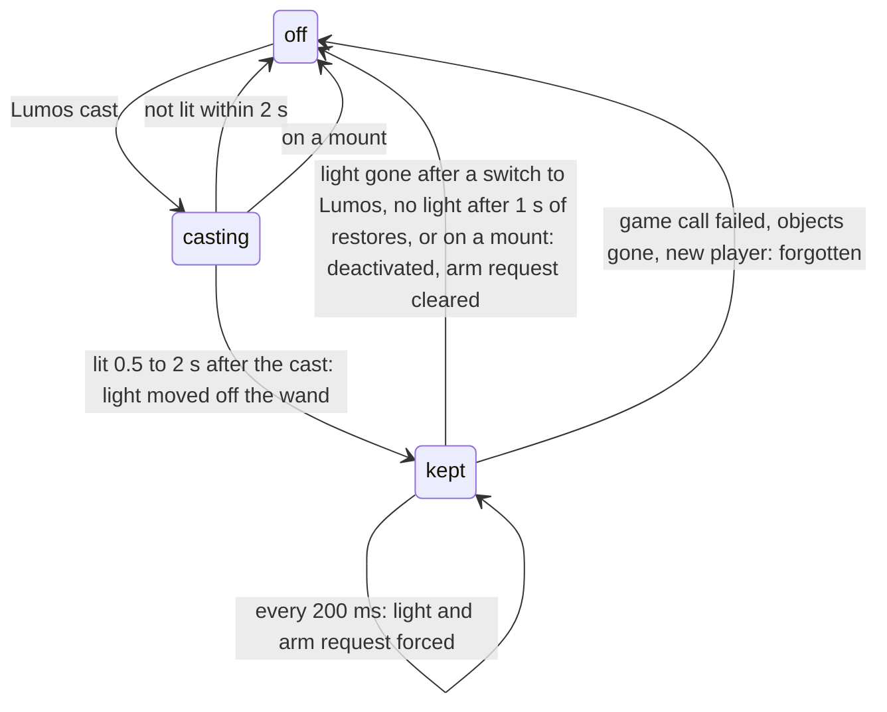

# Hogwarts Legacy Lumos keeper

A UE4SS Lua mod that keeps Lumos lit after you cast it, while you cast other
spells, and keeps the wand raised so the light stays in front of you. Press
Lumos again to put it out.

It replaces the `LumosAlwaysStayOn` mod. Disable that one in `Mods/mods.txt`:
both mods move the same light.

## How it works

Casts come from the shared spell tracker (`hogwarts.spells`), so a Lumos cast
counts however it started: the spell slot, or a quick-cast mod such as
QuickUtils (`WandTool:ActivateSpellTool` then `CastActiveSpell`). Lumos runs
`SpellTool:Start` only when it turns on; a cast is kept if its light is on
0.5 s later.

The game's own light goes out when another spell is cast. A lit cast is moved
off the wand, as `LumosAlwaysStayOn` did: `DeactivateLumos`,
`CancelCurrentSpell`, `ActivateLumos`; other spells then no longer put it out.
The cancel also clears the arm request the game holds for Lumos
(`StartLumos` at the `Lumos` arm priority), so the wand would be put away with
the light at the hip.

While the light is kept, every 200 ms the mod forces its state, whatever
changed it:

- **Light:** on means `IsLumosActive()` and a light actor (`GetLumosActor()`).
  If it is off, `DeactivateLumos` then `ActivateLumos`. After 5 updates in a
  row (1 s) without light, the mod gives up and lets go.
- **Arm:** if the `StartLumos` request at the `Lumos` priority is missing, it
  is set again. Casts take the arm at higher priorities and hand it back when
  they end.

Casting Lumos again turns the kept light off. That runs no `Start`, and from
QuickUtils no spell button press either: the wand switches to the Lumos tool
(`WandTool:OnActiveSpellToolChanged`) and 10–20 ms later the game takes the
light away. Spell set previews switch to it too, but leave the light alone.
So the mod hooks the switch, and a light gone within 0.5 s of a switch to the
kept Lumos tool makes it deactivate the light and clear its arm request, so
the wand comes down. A light gone any other way is restored.

The game has no Lumos on a mount, so getting on one (broom or creature,
`GetIsOnAMountOrInTransition()`) lets go of the light: a kept light is
deactivated and its arm request cleared, a cast not yet kept is dropped. The
next Lumos cast on foot is kept again.

The mod forgets the light without calling the game when:

- a game call fails, e.g. while loading;
- the Lumos spell tool or wand is gone;
- a new player is created (`NotifyOnNewObject` on `Biped_Player`), e.g. after
  loading a save.

`LumosAlwaysStayOn` tried the same arm request, but called it as
`Player.SetRightArmState(...)` instead of `Player:SetRightArmState(...)`; the
call failed inside its `pcall`, so its wand always dropped.

`main.lua` updates every 200 ms on the game thread while the player is in
gameplay (`hogwarts.player`: not paused, in a cinematic or dead), on foot or
on a mount; the spell tracker reports casts only then, and a kept light is
not forced in between.

## Build and debug

- `dist -g hogwarts-legacy -m lumos-keeper` (from the `dev.cmd` shell) builds
  `dist/hogwarts-legacy/lumos-keeper`; copy it to `ue4ss/Mods/lumos-keeper`
  and add `lumos-keeper : 1` to `Mods/mods.txt`.
- The mod logs `[LumosKeeper] Lumos keeper started` on load, then only
  failures: hooks that could not register, failed updates and game calls.

## Verified in game

The devtools experiment `games/hogwarts-legacy/devtools/src/experiments/lumos.lua`
confirmed:

- the cast timing, and the light outlasting other casts after the move;
- `SetRightArmState(StartLumos, Lumos)` holding the wand up through casts
  until `None` clears it;
- how a QuickUtils Lumos cast puts the kept light out (switch, then the light
  goes), and that spell set previews leave it on;
- `DeactivateLumos` then `ActivateLumos` bringing back a light the game put out;
- loading a save creating a new `Biped_Player`, which resets the mod.

Not verified in game yet: this version, with turn-off on the switch and the
release on a mount.
