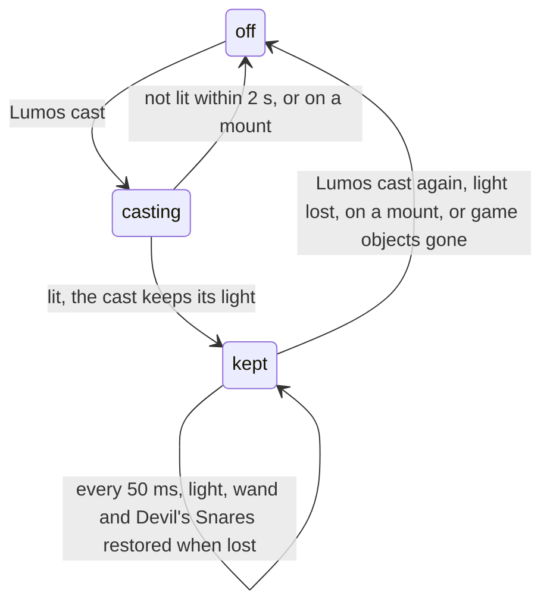

# Hogwarts Legacy Lumos keeper

The Lumos spell won't be disabled anymore after any action that turns it off in the vanilla game (other spell, roll, interaction) and will be kept on until Lumos is cast again.

## How it works

- the mod tracks when Lumos is cast and retriggers the light every 200 ms so the other actions like spells and rolls that usually turn it off don't affect this anymore.
- when Lumos is cast again while active the mod will turn it off.
- on mounts the mod resets its active state.
- the kept light of Lumos always affects the Devil's Snares, so they won't hurt the player.

## Compatibility

The mod should be compatible with any other mod and any game input that triggers the Lumos spell, since this mod tracks the cast itself and doesn't rely on specific key combos.

## Shout outs

- [Lumos Always Stays On](https://www.nexusmods.com/hogwartslegacy/mods/2534) for the inspiration.
