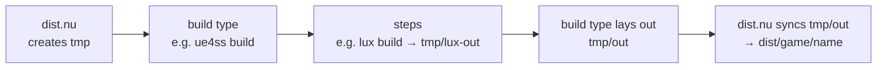

# dist

Build pipeline behind the `dist` command of the `dev.cmd` shell. `dist` runs
`scripts/dist.nu` in a new nu process on every call, so edits here apply
without restarting the shell.

```sh
dist                                          # the mod containing the current directory
dist -g hogwarts-legacy                       # every mod of the game
dist -g hogwarts-legacy -m dualsense-support  # one mod
```

## Mods

A mod is any directory under `games/` with a `mod.toml`:

```toml
name = "dualsense-support"   # -m; output dist/<game>/<name>
game = "hogwarts-legacy"     # -g
[build]
type = "ue4ss"               # a key of BUILD_TYPES in dist.nu
```

To deploy straight into a game installation, list it in `.dist-overrides.toml`
(see `.dist-overrides.example.toml`).

## Pipeline

Each selected mod builds in its own directory `dist/.tmp/<game>-<name>-<random>`
(`tmp` below):



1. `dist.nu` creates `tmp` and calls the mod's build type with `(mod, tmp)`.
2. The build type chains steps (modules such as `lux.nu`) and fills `tmp/out` with the
   mod's final layout.
3. `dist.nu` copies `tmp/out` into `dist/<game>/<name>` (or the override directory), changed files only:
   identical files keep their timestamps, files the build no longer produces
   are not deleted.
4. `tmp` is kept for inspection. Each build first removes the directories in
   `dist/.tmp` last modified more than `TMP_MAX_AGE` (1 day) ago.

## Steps

A step is a module here, reused by build types. It takes the build's `tmp`,
writes only into its own `tmp/<name>` directories and returns the one holding
its result.

`lux build [dir, tmp]` (`lux.nu`) builds the Lux package whose `lux.toml` is in `dir`:

| Directory | Content |
| --- | --- |
| `tmp/archive` | `lx dist flat-archive` output (zip) |
| `tmp/unarchived` | the archive unpacked with `tar` (Windows' bsdtar; GNU tar cannot read zip) |
| `tmp/lux-out` | `src/` and `lib/` merged, plus `lua54.dll` (from `dist/.lua`) when `lib/` has native modules |

Lua lives in `dist/.lua`, passed to `lx` as `--lua-dir`. `lx dist` installs into
a fresh temp tree, so without it Lua is compiled on every run, and that build
is not reproducible: `lua54.dll` would change each time and could not be
replaced while the game holds it. With `--lua-dir`, `lx` builds Lua there once
and reuses it; delete `dist/.lua` to rebuild it.

## Build types

- `ue4ss`: runs `lux build` on the mod's directory and copies `lux-out` into
  `out/Scripts`, where UE4SS loads `main.lua` and resolves `require()`.
